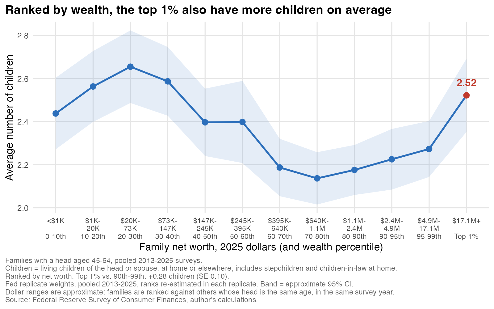

What's the biggest status symbol for the 1%, one that distinguishes them from the merely affluent in the rest of the top 10%? Is it the fancy extra home, or maybe a private jet? Here's an interesting prospect: what if it's having a third kid?

We just got the new Survey of Consumer Finances (SCF) for 2025 last week. This is a big Federal Reserve survey that comes out every three years, with the last being 2022. A useful and distinguishing thing about the SCF is that the Federal Reserve works really hard to get the top 1% well represented, which is hard to do. On top of the regular sample, they draw a sample of wealthy families from IRS records. It's a pain to do this, but it's essential if you want to understand how the economy works in terms of the sheer inequality of who owns what. It's a way we know, for instance, that the wealthiest 10% of families own 81% of the stock held by families, while the bottom 50% own about 1%.

So let's get to kids. Measuring this is going to be tough because, while we get a great look at income and wealth, the Fed's summary data only counts children listed in the household, which leaves out most grown children who have moved out. But by digging into the full survey data, we can build a workable family child count. Let's take that, as well as focusing on mid-life households, with a reference person between 45 and 64. To get enough people in the 1%, I pool the last five surveys, going back to 2013. [All this analysis is here on Github for your AI to replicate](https://github.com/mtkonczal/blogs_2026_10_three_kids_SCF).

For kids, I combine the SCF's household child count with its count of living sons and daughters of either partner who live elsewhere. This includes adopted children and stepchildren. It can also include resident children-in-law and count some children away from home twice, so it is an imperfect family child count, not a direct measure of births. I check these counting concerns below.

Now, the generic, textbook view is that with more income, you have fewer kids. That's what we've seen historically across countries. However, there's a “new era” of economics and fertility research that finds, across rich countries, “the income-fertility relationship has flattened and in some cases reversed, and the cross-country relationship between women's labor force participation and fertility is now positive” [(Doepke et al., 2022)](https://www.nber.org/papers/w29948). People have been writing about this for some time. Economists are increasingly finding a “U-shaped” figure in income (and, in some work, education) for fertility, with some proposing that buying child care cheaply relative to their incomes helps explain it [(Bar et al., 2018)](https://doi.org/10.20955/wp.2018.022). The child and family policy expert Elliot Haspel [wrote in 2019](https://www.romper.com/life/when-people-cant-afford-another-child-we-know-big-families-are-only-for-the-rich-15649230) that when child care costs as much as it does, big families become something only the rich can afford. He finds a remarkable quote from a [2014 *New York Times* article](https://www.nytimes.com/2014/04/10/fashion/The-Growing-Three-Child-Household-in-Manhattan.html) where a New Yorker father says "At some level, the third child is a proxy for having enough wealth to have a very comfortable life."

Much of this work uses Census data like the American Community Survey; I want to try to extend it to the SCF here. So let's do a graph where the x-axis is all mid-life families, grouped by usual income (including capital income) relative to others their age, and the y-axis is the percent of families with a child count of at least three. Across much of the income scale it's pretty flat, around 40 to 43%, and it dips to 37% at the 80th–90th percentiles. But it has a statistically significant rise at the top 1%: 49%, compared with about 40% for the rest of the top 10%.

Under the hood, this is driven by those with exactly three kids: about 34% of the top 1%, versus 24% of the rest of the top 10%. Four or more kids are about equally common in those two groups. At the top of the income distribution, it really is the third kid that stands out.

Is this about a third kid becoming a new cultural symbol for the 1%? Some digging makes me think this isn’t the case and the story might be more fascinating. A third kid isn’t new for them; what’s new is that it has become rarer for everyone else. Compared with the 1990s, families with three or more kids became less common overall and among the rest of the top 10%. The top 1%'s estimated share barely changed, though the uncertainty is substantial. Maybe all the stresses that made childbearing more difficult over the past 30 years just bounced right off the 1%? Here’s a quick glance at that:

The top-1% gap is robust to many different ways of defining the 1%.[^1] Also, because it's the SCF, we can move from income to net worth as well. So here are families ranked by net worth, with approximate dollar labels. The share with three or more kids falls through much of the wealth distribution, from 47% around the 20th–30th percentiles down to 34% around the 70th–80th. Then, at the top 1%, it rises to 50%, compared with about 37% for the rest of the top 10%. So the same pattern shows up when we rank by wealth, and here it's not just the third kid: the top 1% are also more likely to have four or more (19% versus 14%).

Average number of kids by income increases for the 1%, but not in a statistically significant way; the average is noisier, since a few very large families move it a lot. However, ranked by net worth, the top 1% do have a significantly higher average (2.5 versus 2.25 kids), as you can see here:

Remarriage and children counted twice are obvious worries here. But the gap survives even when I restrict the sample to currently married couples in which both spouses report a first marriage and subtract potential duplicate children. It remains statistically significant for both income and wealth. The gap also survives several other checks on how we count families.[^2]

This is a correlation, but it’s the one you’d expect if money solves the hard parts of raising kids. When you’re in the 1%, a lot of the practical difficulties, like paying for childcare or smoothing your income through the hardest few years, probably aren’t as big a problem. I don’t think we can make everyone the 1%, but some of what their money buys them, like stability and support, are things we could provide for families right now. We need to think seriously about a policy agenda for families with young kids, one that targets the years when they’re under the most financial strain.

[^1]: The charts rank families against others whose head is in the same five-year age band (45–49 through 60–64) in the same survey year. But the gap between the top 1% and the rest of the top 10% stays positive and statistically significant, for both income and wealth, if we instead use ten-year age bands, rank all families with a head aged 45 to 64 together, rank against the whole U.S. population, pool all five surveys into one ranking, or use actual rather than usual income. It also holds comparing the top 2% with the 90th–98th percentiles, and the top 0.5% with the 90th–99.5th. Across these, the gap runs from 7 to 15 points by income and 9 to 16 points by wealth.

[^2]: I also checked whether the result depends on how we count families. The top-1% gap remains positive and statistically significant, for both income and wealth, after subtracting the maximum possible overlap between children listed in the household roster and children reported living elsewhere, even when I make that correction only for the top 1%. It also survives restricting the sample to currently married couples in which both spouses report a first marriage, or to reference persons aged 50–64 whose partners, if present, are at least 45. Combining the first-marriage restriction with the duplicate correction leaves gaps of about 12 percentage points by income and 11 by wealth. These checks address specific counting problems; they cannot identify births to one person or exclude every kind of blended family. The full sensitivity results and code are in the linked materials.
