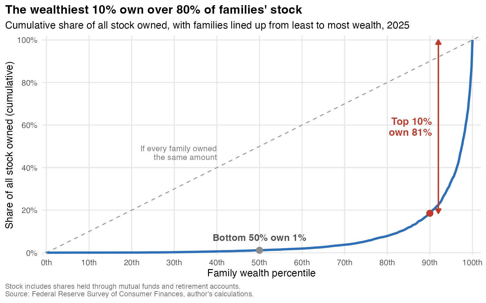
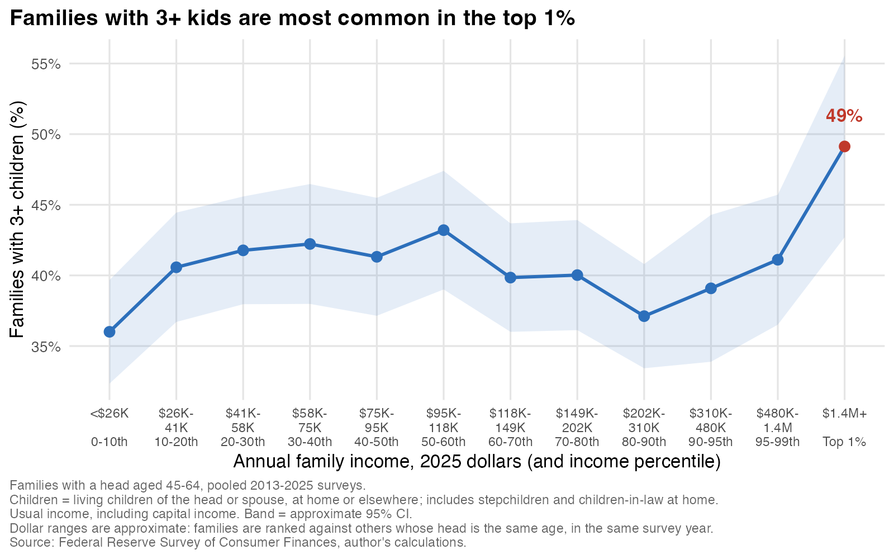
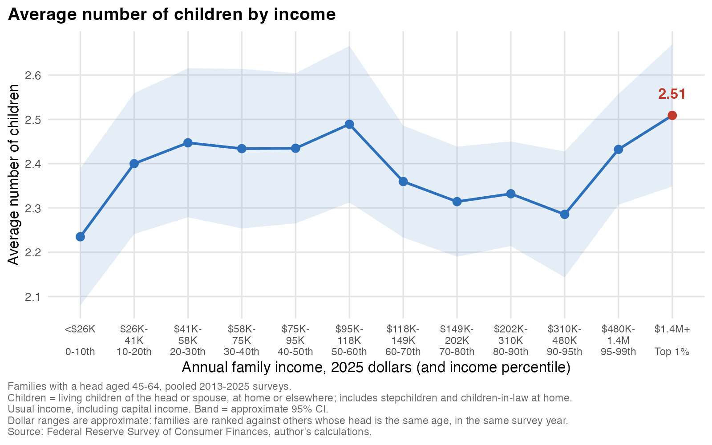
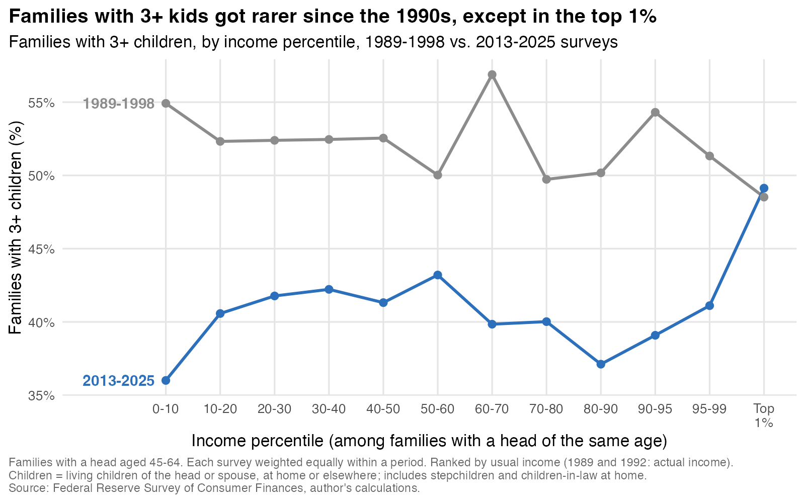
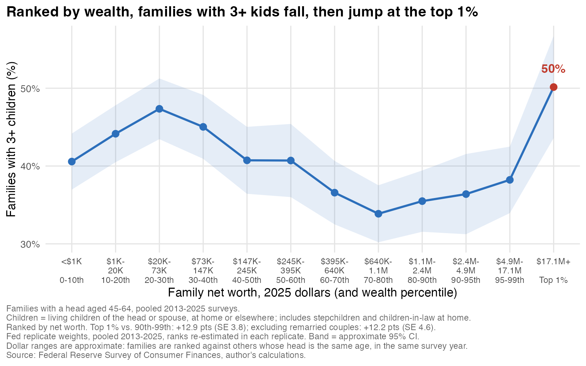

What's the biggest status symbol for the 1% that distinguishes them from the merely affluent? Is it the fancy extra home, or maybe a private jet? Here's an interesting prospect: what if it's having a third kid?

We just got the new Survey of Consumer Finances (SCF) for 2025 last week. This is a big Federal Reserve survey that comes out every three years, with the last being 2022. A great and distinguishing thing about the SCF is that the Federal Reserve works really hard to get the 1% well represented, which is hard to do. On top of the regular sample, they draw a sample of wealthy families from IRS records. It's a pain to do this, but it's absolutely essential if you want to understand how the economy works in terms of the sheer inequality of who owns what.

Here's a quick picture of the distribution of stocks, for instance, from the Survey of Consumer Finances. And here you can see: the bottom 50% of families by wealth own about 1% of the stocks. The wealthiest 10% own 81% of stocks, if you're wondering why the booming stock market is not making people feel better about the economy.

So let's go back to kids. Measuring this is going to be tough because, while we get a great look at income and wealth, the Fed's summary data only counts the children living at home. But by digging into the full survey data, we can add a workable fertility question. Let's take that, as well as focusing on mid-life households, with a reference person between 45 and 64. To get enough people in the 1%, I pool the last five surveys, going back to 2013. [All this analysis is here on Github for your AI to replicate](https://github.com/mtkonczal/blogs_2026_10_three_kids_SCF).

For kids, I combine the SCF's household child count with its count of living sons and daughters of either partner who live elsewhere ("how many sons and daughters do you (or your spouse) have who do not live with you?"). This includes stepchildren, and children-in-law who live in the household, so it is an imperfect family count, not a direct measure of births. But I think it's workable.

Now, the generic, textbook view is that with more income, you have fewer kids. That's what we've seen across countries. That's what we've seen historically. And so we'd expect that if we take the number of kids and plot it against incomes, we'll see it declining.

However, there's been a [newer line of research](https://www.nber.org/papers/w29948) showing that relationship is changing: in rich countries it has flattened, and in some cases reversed. Elliot Haspel [has written](https://www.romper.com/life/when-people-cant-afford-another-child-we-know-big-families-are-only-for-the-rich-15649230) about what this means for families, arguing that when child care costs this much, big families become something only the rich can afford. Economists have made this argument, too: [Bar and coauthors](https://doi.org/10.20955/wp.2018.022) document rising fertility among higher-income American families and propose that buying child care cheaply relative to their incomes helps explain it.

Researchers have found this in Census data like the American Community Survey. The advantage there is huge samples. However, incomes tend to be top-coded, so it's hard to see the richest families. Related work like Hazan and Zoabi's ["Do Highly Educated Women Choose Smaller Families?"](https://doi.org/10.1111/ecoj.12148) uses the ACS to find a U-shape in fertility rates by women's education. The SCF lets us look at the very top directly.

So let's do a graph where the x-axis is all mid-life families, grouped by usual income (including capital income) relative to others their age, and the y-axis is the percent of families with a child count of at least three. Across much of the income scale it's pretty flat, around 40 to 43%, and it dips to 37% at the 80th–90th percentiles. But it has a statistically significant rise at the top 1%: 49%, compared with about 40% for the rest of the top 10%.

Under the hood, this is driven by those with exactly three kids: about 34% of the top 1%, versus 24% of the rest of the top 10%. Four or more kids are about equally common in those two groups. So the third kid really is that sign you made it!

We can also do an average number of kids. The top 1% average about 2.5, compared with 2.35 for the rest of the top 10%. That's a smaller gap, and not one I can distinguish from noise.

Is this new? The gap looks larger in the more recent surveys. Back in the earliest period, 1989–1998, the rest of the top 10% looked much more like the top 1%. Notice the pattern in these period averages: about 48 to 49% of top-1% families have a child count of three or more in each period, while the rest of the top 10% fell from about 53% to 40%. There is a lot of survey-to-survey noise here, and the timing depends on how we measure income: the earliest surveys use actual income, while later ones use usual income. These are also survey dates, not the dates when the children were born.

Because it's the SCF, we can move from income to net worth as well. So here are families ranked by net worth, with approximate dollar labels. The share with three or more kids falls through much of the wealth distribution, from 47% around the 20th–30th percentiles down to 34% around the 70th–80th. Then, at the top 1%, it rises to 50%, compared with about 37% for the rest of the top 10%. So the same pattern shows up when we rank by wealth.

(We did note that remarriages among the 1% could be complicating this question, given the wording of the fertility question. But excluding couples where either partner has been married more than once leaves a positive, statistically significant gap for both income and wealth in the five-survey pool. That doesn't rule out every kind of blended family, but remarriage doesn't explain away the result.)

This is a correlation, but it's the one you'd expect if money solves the hard parts of raising kids. When you're in the 1%, a lot of the practical difficulties of childcare, of smoothing your income to get through the difficult few years, are probably not as big a problem. I don't think we can make everyone the 1%, but some of the things their money gives them like stability and support are things we could provide for young families right now. Why aren't we doing it?