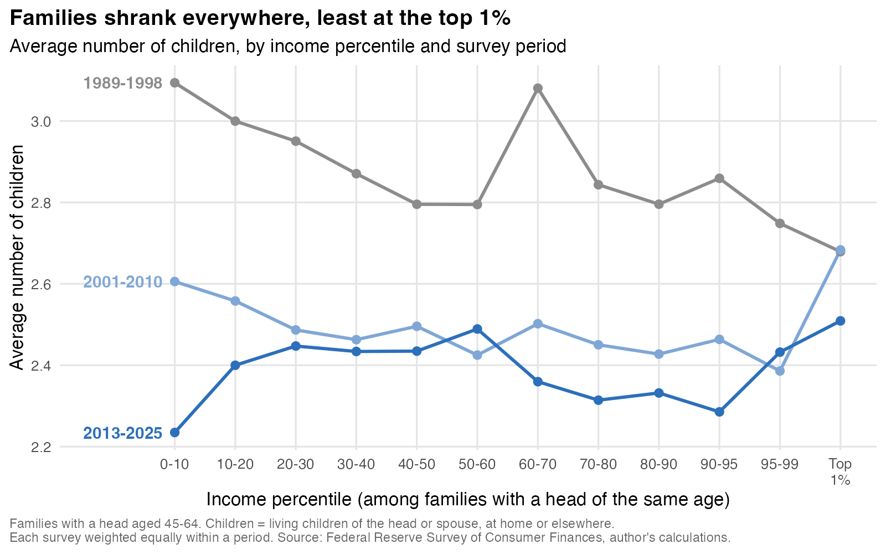

```{r setup}
#| include: false
# Every number in this document is read from files the pipeline writes, so rerunning
# the scripts (section 9) and re-rendering keeps text and estimates in sync.
suppressPackageStartupMessages({ library(data.table); library(haven) })
nums <- fread("graphics/post_numbers.csv")
num <- function(k) { v <- nums[item == k, value]; if (length(v) != 1) stop("post_numbers.csv: missing or duplicate item ", k); v }
se_of <- function(k) as.numeric(sub(".*SE ([0-9.]+).*", "\\1", nums[item == k, note]))
p0 <- function(x) sprintf("%.0f%%", x)
p1 <- function(x) sprintf("%.1f", x)
d2 <- function(x) sprintf("%.2f", x)
usd <- function(x) ifelse(x >= 1e6, sprintf("$%.1f million", x / 1e6), sprintf("$%s", format(round(x / 1e3) * 1e3, big.mark = ",")))
main <- readRDS("output/kids_main.rds")
bl <- readRDS("output/kids_blended.rds")
ww <- readRDS("output/kids_wealth_work.rds")
rec <- main[period == "2013-2025"]
n_rec <- rec[, uniqueN(case)]
n_top1 <- rec[inc_bin == "Top 1%", uniqueN(case)]
built <- nums$built_at[1]
```

::: {.callout-note}
## What this is

This document explains, from the ground up, how the children-by-income numbers in `post_text.md` were produced: what the Survey of Consumer Finances (SCF) is, where its files live, the quirks of working with its microdata, how the sample and the children count are defined, how standard errors are computed, and which script produces which chart. Numbers below are pulled from `graphics/post_numbers.csv` (built `r built`) and the `output/` files. The fact-check log is `post_factcheck.md`.
:::

# The SCF in one page

The Survey of Consumer Finances is a household survey run by the Federal Reserve Board every three years. It is the main source for the distribution of US household wealth. The modern, comparable series starts in 1989, so there are 13 waves through 2025. Each wave interviews roughly 3,000 to 6,500 families about their balance sheets (assets and debts), their income, and their demographics.

Three features of its design matter for this project.

**It oversamples the rich, on purpose.** The SCF uses two samples. One is a standard area-probability sample of US households. The other is a "list sample" drawn from IRS Statistics of Income tax records, which heavily oversamples high-income and high-wealth families. People on the Forbes 400 list are excluded. Weights bring the combined sample back to the population. This is why the SCF can say something about the top 1%: a standard household survey of a few thousand families would have a few dozen of them at most.

**"Family" and "head" have specific meanings.** The unit is the *primary economic unit* (PEU): the core individual or couple who own or rent the home, plus everyone financially dependent on them. It is almost always the same as the household. The Fed labels one person the "reference person," and calls them the "head" in its publications. The 2025 codebook defines the reference person as the single core individual in a PEU without a core couple, and in a couple as "the male in a mixed-sex couple or the older individual in the case of a same-sex couple." When this document says "head aged 45-64," it means that person's age.

**Timing.** Balance-sheet questions refer to the interview date. Income questions refer to the *previous calendar year*: the 2025 survey asks about 2024 income.

# Where the data live

Everything is published at the Fed's SCF page, <https://www.federalreserve.gov/econres/scfindex.htm>. There is no login or API key. Each wave has its own page with download links; the file names follow fixed patterns, so they can be pulled directly from `https://www.federalreserve.gov/econres/files/`. This project uses three kinds of files.

| File | What it is | Fed file name (2025 example) | Where it lives here | Used for |
|---|---|---|---|---|
| **Summary extract** | About 350 cleaned, Fed-constructed variables per family (net worth, income, `KIDS`, age, marital status, race, education...) in a consistent format across waves. Dollar values are restated in 2025 dollars for every wave. | `scfp2025excel.zip` (one CSV inside, despite the name) | `data_raw/zips/`, unzipped to `data_raw/xlsx/SCFP{YEAR}.csv` | Income, net worth, age, children at home, weights, stock holdings |
| **Full public data set** | Every question as asked, about 5,000+ raw variables named `X1`, `X5910`, etc. Dollar values are nominal. | `scf2025s.zip` (Stata `.dta` inside); older waves are `scf89s.zip` ... `scf2016s.zip` | `data_raw/full/p{YY}i6.dta` (1992 is `p92i4.dta`) | Children living elsewhere (`X5910`), prior marriages, work status and hours, wage income |
| **Replicate weights** | 999 bootstrap replicate weights for computing sampling standard errors. | `scf2025rw1s.zip` | `data_raw/rw/p{YY}_rw1.dta` (2019, 2022, 2025 only) | Standard errors on the headline gaps |

The **codebook** for each wave documents every `X` variable: exact question wording, codes, and disclosure edits. It is a plain-text file at `https://www.federalreserve.gov/econres/files/codebk{YEAR}.txt`. Copies for 2013, 2019, 2022 and 2025 are in `docs/`. To look up a variable, search the codebook for its name at the start of a line, for example `grep -n "^X5910" docs/codebk2025.txt`.

The full-data files are large (about 0.2-0.3 GB each as `.dta`, 2.9 GB for all 13 waves). `R/01_download.R` fetches only the summary extracts. The full-data and replicate-weight files were downloaded by hand. To fetch them from scratch (run from the project root):

```bash
# Full public data, all 13 waves (1989-1998 use two-digit years in the file name)
for y in 89 92 95 98 01; do curl -sL -o data_raw/full/scf${y}s.zip https://www.federalreserve.gov/econres/files/scf${y}s.zip; done
for y in 2004 2007 2010 2013 2016 2019 2022 2025; do curl -sL -o data_raw/full/scf${y}s.zip https://www.federalreserve.gov/econres/files/scf${y}s.zip; done
# Replicate weights for the three waves used in the standard errors
for y in 2019 2022 2025; do curl -sL -o data_raw/rw/scf${y}rw1s.zip https://www.federalreserve.gov/econres/files/scf${y}rw1s.zip; done
# Unzip in place
for f in data_raw/full/*.zip; do unzip -o "$f" -d data_raw/full; done
for f in data_raw/rw/*.zip; do unzip -o "$f" -d data_raw/rw; done
```

# Five things that trip up new SCF users

## Every family appears five times (multiple imputation)

When respondents skip a question or answer with a range, the Fed fills in the missing value by statistical imputation. Rather than release one guess, it releases **five complete copies of the data set** ("implicates"), each with a different random draw for the imputed values. So a file with 4,360 families has 21,800 rows.

Two ID variables tie this together: `YY1` is the family's case number and `Y1` = 10 × `YY1` + implicate number (1 to 5). Here is one 2025 family across its five implicates. Age and the number of children at home were answered and are the same in every row; net worth and income contain imputed components and differ.

```{r}
#| label: implicates
sx <- readRDS("data/scf_linked.rds")
ex <- sx[year == 2025, if (uniqueN(NETWORTH) == 5 && uniqueN(INCOME) > 1) .SD, by = YY1][YY1 == min(YY1)]
ex[, .(year, YY1, Y1, implicate, AGE, KIDS, NETWORTH = round(NETWORTH), INCOME = round(INCOME), WGT = round(WGT))]
```

The weight also differs slightly across implicates, because the Fed computes it separately for each one. That is another reason to always carry `WGT` row by row rather than attaching one weight per family.

The project's convention (in `R/scf_functions.R`) is to compute point estimates on the **pooled** file: all five implicates stacked, each weighted. For means that is identical to averaging the five implicate-level estimates. The spread *across* implicates is imputation uncertainty, and it enters the standard errors (section 6).

## Weights are essential, and the extract's weight is pre-divided by 5

Because of the oversample, unweighted SCF statistics are meaningless for population questions. In the summary extract the weight `WGT` is already divided by 5, so summing it over all rows of a wave (all five implicates) gives the number of US families. The full data set's weight, `X42001`, is *not* divided by 5. This project always uses `WGT` from the extract.

```{r}
#| label: weights
sx[, .(sample_families = uniqueN(YY1), rows = .N, us_families_millions = round(sum(WGT) / 1e6, 1)), by = year][order(year)]
```

The oversample is visible in our own analysis sample. Pooling 2013-2025, families in the top 1% of income (for their age) are **`r n_top1`** of the **`r format(n_rec, big.mark = ",")`** families in the sample, or `r p0(100 * n_top1 / n_rec)` of the unweighted cases, though they represent 1% of families once weighted. That is what makes a top-1% estimate possible at all.

## Dollar units differ between the two data sets

The summary extract restates every wave in the dollars of the newest survey (2025 dollars, deflated by the Fed with CPI-U-RS). The full public data are in nominal dollars. In this project **all dollar amounts used in comparisons come from the extract** (`INCOME`, `NORMINC`, `NETWORTH`, `EQUITY`). From the full data we take only counts (children), codes (marital history, work status), hours, and wages used within a single wave (ranks and ratios), where nominal units do not matter.

## Unasked questions are often coded 0, not missing

Many codebook entries use `0` for "Inap." (inapplicable: the question was skipped for this family) and negative codes for special answers. `X5910` codes "None" as `-1`. Always read the codebook entry before using a raw variable. `R/07_kids_income.R` converts `X5910` with `pmax(x5910, 0)` so that "None" becomes 0.

```{r}
#| label: raw-x5910
# Raw coding of X5910 in the 2025 full public file, before any recoding (implicate 1 only)
f25 <- as.data.table(zap_labels(read_dta("data_raw/full/p25i6.dta", col_select = c(y1, x5910))))
f25[y1 %% 10 == 1, .N, by = .(x5910)][order(x5910)]
```

## The public file is not the Fed's internal file

To protect respondents, the public data are altered before release: some values are top-coded (`X5910` at 10), rounded, or perturbed, and some variables are withheld. Published Fed tables use the internal data, so public-file estimates can differ slightly, especially means of skewed variables at the very top.

# Building the analysis file

The pipeline joins the summary extract to the full public data, family-implicate by family-implicate, on `Y1`.

```
R/01_download.R  -> data_raw/xlsx/SCFP{YEAR}.csv           summary extracts, 13 waves
R/02_build_db.R  -> data/scf_linked.rds                    extracts stacked: 312,540 family-implicate rows
R/07_kids_income.R  -> output/kids_main.rds                adds X5910 etc. from data_raw/full/*.dta, builds the sample
R/24_kids_blended.R -> output/kids_blended.rds             remarried-couple robustness
R/23_kids_wealth_work.R -> output/kids_wealth_work.rds     work hours within the top 1% by wealth
R/22_post_kids_graphics.R -> graphics/*.png, graphics/post_numbers.csv
```

**`R/02_build_db.R`** reads the 13 extract CSVs and stacks them into one table, `scf_linked.rds`. It renames the 1989 IDs (`X1`/`XX1`) to `Y1`/`YY1`, computes `implicate`, and checks that every wave has implicates 1-5 with equal rows and no duplicate IDs. It stops with an error if any check fails. Its one edit to the Fed's values: the usual-income category variables are blanked in 1989 and 1992, because usual income was not asked in those waves. It is a pooled cross-section, not a panel. Case 1001 in 2019 and case 1001 in 2022 are different families.

**`R/07_kids_income.R`** reads a handful of raw variables from each wave's full file (handling the 1989 file's uppercase names and `X1` ID), merges them onto the extract by year and `Y1`, and checks that no rows are lost in the merge. It then defines everything below.

# Definitions

## Children

$$
\text{kids} \;=\; \underbrace{\texttt{KIDS}}_{\text{children living at home}} \;+\; \underbrace{\max(\texttt{X5910},\,0)}_{\text{children living elsewhere}}
$$

- `KIDS` (summary extract): children of the reference person or spouse/partner who live in the household.
- `X5910` (full data, asked in every wave since 1989): *"Altogether, including children from previous marriages and adopted children, how many sons and daughters do you (or your spouse/partner) have who do not live with you?"* Interviewers are told to include only living children and stepchildren. It is top-coded at 10 in the public data.

The SCF never asks "how many children have you ever had." The sum above is the closest available measure. It counts adopted children and stepchildren, and it misses children who have died.

## Sample: families with a head aged 45 to 64

Restricting to heads aged 45-64 means most families have finished having children (so the count approximates completed fertility), and most children have not yet died. The trade-off is that income and wealth are measured *after* the children arrive (section 8).

## Income and wealth ranks

- **Income measure.** `NORMINC`, the family's "usual" income: respondents are asked whether last year's income was unusually high or low, and if so, what it would have been in a normal year. Using it keeps a one-off capital gain or a bad year from moving a family into or out of the top 1%. `NORMINC` was not asked in 1989 and 1992, so those waves use actual `INCOME`. Both include all sources: wages, business income, interest, dividends, capital gains, rents, transfers.
- **Ranking within age band.** Each family gets a weighted percentile rank (the midpoint of its cumulative weight) among families **in the same survey year, implicate, and 5-year age band of the head** (45-49, 50-54, 55-59, 60-64). This compares families at the same stage of life: a 62-year-old near retirement is ranked against other 60-64-year-olds, not against 50-year-olds at peak earnings. Net worth (`NETWORTH`) is ranked the same way.
- **Bins.** Ten deciles, with the top decile split into 90th-95th, 95th-99th and the top 1%.
- **Dollar labels on the charts.** The x-axis labels show the income at each percentile cutoff among all heads 45-64 (pooled 2013-2025, 2025 dollars). Because the ranks are within age bands, these are approximate: 58-87% of each bin's families fall inside its labeled range, best at the top. The top-1% cutoff is about **`r usd(num("income_cutoff_P99_2013_25"))`** of usual income; the median top-1% family has about **`r usd(num("median_usual_income_top1bin_2013_25"))`**.

## Pooling waves

The 2025 wave has only `r num("n_top1_families_2025")` top-1% families in this age range, too few for stable estimates. The main estimates pool the five most recent surveys, **2013, 2016, 2019, 2022 and 2025**. The over-time chart uses three periods: 1989-1998, 2001-2010 and 2013-2025.

Within a period each **wave gets equal total weight** (`w = WGT / sum(WGT)` within each year and implicate). Without this, later waves would count for more simply because the population grew.

# Estimation and standard errors

**Point estimates.** Weighted shares and means on the pooled implicates, using `w`.

**Approximate standard errors (the shaded bands on the charts).** For each implicate separately, a weighted regression of the outcome on bin dummies (`fixest::feols`, standard errors clustered on family, which within one implicate amounts to heteroskedasticity-robust errors). The five results are combined with **Rubin's rules**:

$$
\bar{\theta} = \tfrac{1}{5}\textstyle\sum_m \hat{\theta}_m, \qquad
T = \underbrace{\tfrac{1}{5}\textstyle\sum_m \widehat{V}_m}_{\text{within-implicate}} + \left(1+\tfrac{1}{5}\right)\underbrace{\tfrac{1}{4}\textstyle\sum_m (\hat{\theta}_m - \bar{\theta})^2}_{\text{between-implicate}}, \qquad \text{SE} = \sqrt{T}.
$$

These ignore the SCF's stratified sample design, so they are approximate.

**Replicate-weight standard errors (the significance claims).** The Fed's replicate-weight file gives 999 alternative weights for each family, each mimicking a redraw of the sample. `R/rep_se.R` follows the Fed's recipe:

1. Compute the statistic on implicate 1 with each of the 999 replicate weights (replicate weight *r* = `wt1b`*r* × `mm`*r*).
2. Sampling variance $V_s = \frac{1}{998}\sum_r (\hat{\theta}_r - \bar{\theta}_r)^2$.
3. Add imputation variance: $\text{SE} = \sqrt{V_s + 1.2\,B}$, where $B$ is the variance of the statistic across the five implicates.

Replicate weights were only downloaded for 2019, 2022 and 2025. The headline significance tests therefore use the **equal-weighted average of those three waves**, with $\text{SE} = \sqrt{\sum \text{SE}_y^2}/3$ (the waves are independent samples). Percentile ranks are held fixed across replicates, which slightly understates the standard errors. This is why the post quotes two slightly different sets of numbers: pooled 2013-2025 levels for the charts, and 2019-2025 averages for the tests.

# Every chart and number in the post

## Chart 1: who owns the stock market (2025)


All families in 2025 (not just ages 45-64), sorted by net worth. `EQUITY` from the extract is stock held directly *and* indirectly through mutual funds and retirement accounts. The bottom 50% by wealth own **`r p1(num("equity_share Ranked by wealth Bottom 50%"))`%** of stock (SE `r se_of("equity_share Ranked by wealth Bottom 50%")`); the wealthiest 10% own **`r p0(num("equity_share Ranked by wealth Top 10%"))`**. `r p0(num("stock_owners_pct_2025"))` of families own any stock. Ranking by stock holdings instead of wealth gives a top-10% share of `r p0(num("equity_share Ranked by stock holdings Top 10%"))`, which is why the post says "wealthiest 10%." Standard errors use 2025 replicate weights.

## Charts 2 and 3: children by income, 2013-2025


| Income group | 3+ children | SE | Average children | SE |
|---|---|---|---|---|
| Bottom 10% | `r p0(num("share3p_2013_25 P0-10"))` | `r se_of("share3p_2013_25 P0-10")` | `r d2(num("mean_kids_2013_25 P0-10"))` | `r se_of("mean_kids_2013_25 P0-10")` |
| 40th-50th | `r p0(num("share3p_2013_25 P40-50"))` | `r se_of("share3p_2013_25 P40-50")` | `r d2(num("mean_kids_2013_25 P40-50"))` | `r se_of("mean_kids_2013_25 P40-50")` |
| 50th-60th | `r p0(num("share3p_2013_25 P50-60"))` | `r se_of("share3p_2013_25 P50-60")` | `r d2(num("mean_kids_2013_25 P50-60"))` | `r se_of("mean_kids_2013_25 P50-60")` |
| 80th-90th | `r p0(num("share3p_2013_25 P80-90"))` | `r se_of("share3p_2013_25 P80-90")` | `r d2(num("mean_kids_2013_25 P80-90"))` | `r se_of("mean_kids_2013_25 P80-90")` |
| 90th-95th | `r p0(num("share3p_2013_25 P90-95"))` | `r se_of("share3p_2013_25 P90-95")` | `r d2(num("mean_kids_2013_25 P90-95"))` | `r se_of("mean_kids_2013_25 P90-95")` |
| 95th-99th | `r p0(num("share3p_2013_25 P95-99"))` | `r se_of("share3p_2013_25 P95-99")` | `r d2(num("mean_kids_2013_25 P95-99"))` | `r se_of("mean_kids_2013_25 P95-99")` |
| **Top 1%** | **`r p0(num("share3p_2013_25 Top 1%"))`** | `r se_of("share3p_2013_25 Top 1%")` | **`r d2(num("mean_kids_2013_25 Top 1%"))`** | `r se_of("mean_kids_2013_25 Top 1%")` |

Standard errors are the approximate Rubin's-rules SEs (percentage points and children). The formal tests, using replicate weights (2019-2025 average):

- Top 1% vs. 90th-99th, share with 3+ children: **`r sprintf("%+.1f", num("rw 2019-25 avg gap_top1_p90_99"))` points** (SE `r p1(se_of("rw 2019-25 avg gap_top1_p90_99"))`). Significant.
- Top 1% vs. the middle (40th-60th): `r sprintf("%+.1f", num("rw 2019-25 avg gap_top1_mid"))` points (SE `r p1(se_of("rw 2019-25 avg gap_top1_mid"))`). Not significant at 5%. This is why the post claims more big families than the *affluent*, not more than everyone.
- Average children, top 1% vs. 90th-99th: `r sprintf("%+.2f", num("rw 2019-25 avg k_gap_top1_p90_99"))` (SE `r d2(se_of("rw 2019-25 avg k_gap_top1_p90_99"))`). Significant.

The pattern is not stable wave to wave: in 2025 alone the gap is `r sprintf("%+.0f", num("rw 2025 gap_top1_p90_99"))` points (SE `r round(se_of("rw 2025 gap_top1_p90_99"))`), in 2022 it is `r sprintf("%+.0f", num("rw 2022 gap_top1_p90_99"))` (SE `r round(se_of("rw 2022 gap_top1_p90_99"))`). Pooling is necessary.

**Blended families.** A natural worry is that rich men remarry and combine children from several relationships. The public SCF cannot identify stepchildren directly, but it does record whether each partner was married before (`X7377`, `X7392`). `R/24_kids_blended.R` drops couples where either partner was previously married, keeping each family's rank from the full sample. Those couples report more children on average (`r d2(bl$couples_overall$remarried)` vs. `r d2(bl$couples_overall$first_marr)` for first-marriage couples). Without them, the income result holds: top 1% vs. 90th-99th is `r sprintf("%+.1f", bl$rw_excl_remarried[rank == "inc_rank" & stat == "gap3", est])` points (SE `r p1(bl$rw_excl_remarried[rank == "inc_rank" & stat == "gap3", se])`) and `r sprintf("%+.2f", bl$rw_excl_remarried[rank == "inc_rank" & stat == "gapk", est])` children (SE `r d2(bl$rw_excl_remarried[rank == "inc_rank" & stat == "gapk", se])`).

## Charts 4 and 4b: has this changed over time?




Same sample and definitions, run separately for 1989-1998, 2001-2010 and 2013-2025, using all 13 waves. Ranks are within each wave, so these charts use percentile labels, not dollars (real incomes at a given percentile differ across periods). The top 1% share with 3+ children is `r p0(num("share3p 1989-1998 Top 1%"))`, `r p0(num("share3p 2001-2010 Top 1%"))` and `r p0(num("share3p 2013-2025 Top 1%"))` across the three periods; the middle (50th-60th) goes from `r p0(num("share3p 1989-1998 P50-60"))` to `r p0(num("share3p 2013-2025 P50-60"))`.

A regression of 3+ children on a top-1% dummy, with age and year fixed effects, among the top 10% only, gives the top-1% gap relative to the 90th-99th in each period:

| Period | Gap (points) | SE (approx.) |
|---|---|---|
| 1989-1998 | `r sprintf("%+.1f", num("gap_top1_vs_p90_99_ageyear 1989-1998"))` | `r p1(se_of("gap_top1_vs_p90_99_ageyear 1989-1998"))` |
| 2001-2010 | `r sprintf("%+.1f", num("gap_top1_vs_p90_99_ageyear 2001-2010"))` | `r p1(se_of("gap_top1_vs_p90_99_ageyear 2001-2010"))` |
| 2013-2025 | `r sprintf("%+.1f", num("gap_top1_vs_p90_99_ageyear 2013-2025"))` | `r p1(se_of("gap_top1_vs_p90_99_ageyear 2013-2025"))` |

## Charts 5 and 5b: ranking by wealth instead of income


Identical to charts 2 and 3, but families are ranked by net worth within age band. The top-1% wealth cutoff is about **`r usd(num("networth_cutoff_P99_2013_25"))`**. The share with 3+ children peaks at `r p0(num("share3p_networth_2013_25 P20-30"))` in the 20th-30th percentile (about `r usd(num("networth_cutoff_P20_2013_25"))` to `r usd(num("networth_cutoff_P30_2013_25"))`), falls to `r p0(num("share3p_networth_2013_25 P70-80"))` in the 70th-80th (about `r usd(num("networth_cutoff_P70_2013_25"))` to `r usd(num("networth_cutoff_P80_2013_25"))`), then is `r p0(num("share3p_networth_2013_25 Top 1%"))` at the top 1%. Average children follow the same shape: `r d2(num("mean_kids_networth_2013_25 P20-30"))`, `r d2(num("mean_kids_networth_2013_25 P70-80"))`, and `r d2(num("mean_kids_networth_2013_25 Top 1%"))`.

The evidence is weaker here. Replicate-weight gap, top 1% vs. 90th-99th: `r sprintf("%+.1f", num("rw_networth 2019-25 avg gap_top1_p90_99"))` points (SE `r p1(se_of("rw_networth 2019-25 avg gap_top1_p90_99"))`), just significant at 5%; for average children, `r sprintf("%+.2f", num("rw_networth 2019-25 avg k_gap_top1_p90_99"))` (SE `r d2(se_of("rw_networth 2019-25 avg k_gap_top1_p90_99"))`), borderline. Dropping remarried couples shrinks the wealth gap to `r sprintf("%+.1f", bl$rw_excl_remarried[rank == "nw_rank" & stat == "gap3", est])` points (SE `r p1(bl$rw_excl_remarried[rank == "nw_rank" & stat == "gap3", se])`), not significant. Hence the post's "less certain."

## Work hours within the top 1% by wealth

`R/23_kids_wealth_work.R` adds usual weekly hours on the main job for the head (`X4110`) and spouse/partner (`X4710`), summed, with 0 for those not working. Among families in the top 1% of wealth (pooled 2013-2025):

```{r}
#| label: hours
h <- rbind(ww$top1w_by_hours[, sample := "All families"],
           ww$top1w_by_hours_excl_remarried[, sample := "Excluding remarried couples"])
h[, .(sample, group, `3+ children (%)` = round(share3p, 1), SE = round(se3, 1), families = n_fam,
      `median hours` = med_hours, `median net worth ($M)` = round(med_nw_m, 1))]
```

The difference (under 40 minus 40+ hours) is `r sprintf("%+.1f", ww$top1w_hours_gap[sample == "All families", est])` points (SE `r p1(ww$top1w_hours_gap[sample == "All families", se])`), or `r sprintf("%+.1f", ww$top1w_hours_gap[sample != "All families", est])` (SE `r p1(ww$top1w_hours_gap[sample != "All families", se])`) without remarried couples. Hours are measured at 45-64, long after most children were born.

# Caveats

- **Reverse causation.** Income, wealth and hours are measured when the head is 45-64, after the children. Children can lower family earnings (especially mothers'), which would push large families down the income ranks in the middle of the distribution more than at the top, where income is mostly from capital. The post treats the results as correlations.
- **Children count.** Includes stepchildren and adopted children; excludes children who died. `X5910` is top-coded at 10. "Remarried couple" is a proxy for possible stepchildren, not a direct measure.
- **Age-band ranks.** "Top 1%" means top 1% among families whose head is the same age. Dollar labels on charts are approximate.
- **Public-data edits** (top-coding, rounding, perturbation) mainly affect the very top.
- **Approximate SEs on the charts.** The shaded bands ignore the sample design. The significance claims in the post rely on replicate weights, which exist here for 2019-2025 only.
- **Who is the head.** In mixed-sex couples the reference person is the man, so "head aged 45-64" is the man's age. For families where the woman is younger, her childbearing may be less complete.

# Reproducing everything

Run from the project root. The first two steps only need rerunning if the raw data change.

```bash
Rscript R/01_download.R            # summary extracts -> data_raw/xlsx/, writes data_raw/download_manifest.csv
Rscript R/02_build_db.R            # -> data/scf_linked.rds
Rscript R/07_kids_income.R         # -> output/kids_main.rds (needs data_raw/full/*.dta)
Rscript R/24_kids_blended.R        # -> output/kids_blended.rds (needs data_raw/rw/*.dta)
Rscript R/23_kids_wealth_work.R    # -> output/kids_wealth_work.rds
Rscript R/22_post_kids_graphics.R  # -> graphics/*.png, graphics/post_numbers.csv
quarto render kids_methods.qmd     # this document
```

Order matters: 07 first, 24 before 22 (22 reads its output), and 22 before rendering this file. Checks that a run worked: 02 prints families per wave (about 4,360 sample families and 135 million US families in 2025); 07 prints the main sample size (`r format(main[, uniqueN(case)], big.mark = ",")` families across 13 waves); 22 ends by reporting that it wrote `r nrow(nums)` numbers to `graphics/post_numbers.csv`.

R packages: `data.table`, `haven`, `fixest`, `ggplot2`, `scales`, `ragg`, `dplyr` (for `all_of` when selecting columns from `.dta` files).

## File map

| Path | Role |
|---|---|
| `post_text.md` | The post |
| `post_factcheck.md` | Fact-check log and the history of specification decisions |
| `kids_methods.qmd` | This document |
| `R/scf_functions.R` | Weighted quantile and mean helpers |
| `R/rep_se.R` | Replicate-weight standard errors |
| `R/01_download.R`, `R/02_build_db.R` | Summary-extract download and stacking |
| `R/07_kids_income.R` | Merge with full data; children count; sample; ranks |
| `R/22_post_kids_graphics.R` | All charts and `post_numbers.csv` |
| `R/23_kids_wealth_work.R` | Work hours within the top 1% by wealth |
| `R/24_kids_blended.R` | Remarried-couple robustness |
| `data_raw/` | Raw Fed files (zips kept as the record of what was downloaded) |
| `docs/codebk*.txt` | Fed codebooks |
